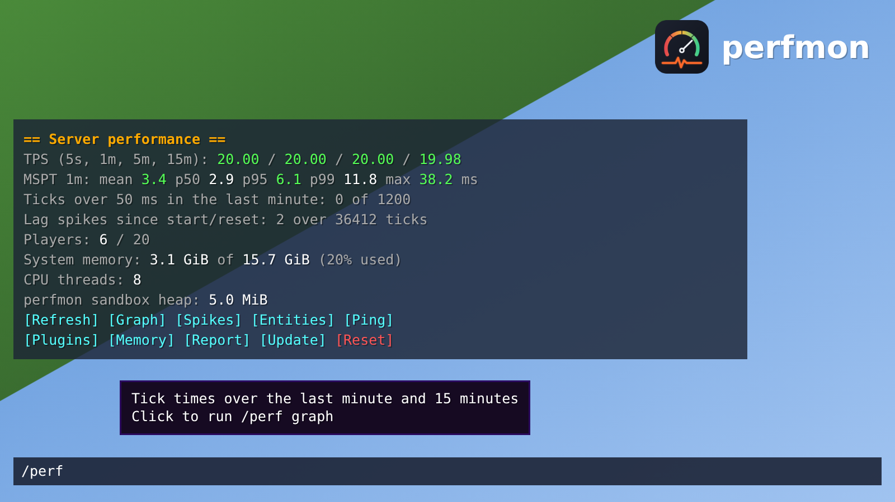
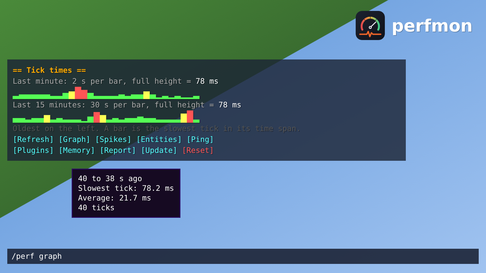

# perfmon: performance and debug plugin for Pumpkin


`Perfmon.wasm` is a [Pumpkin](https://github.com/Pumpkin-MC/Pumpkin) plugin. It times every server
tick, keeps 15 minutes of history, flags lag spikes, graphs tick times, counts entities, reports
memory and player ping, shows which plugins lag, spike or leak (for plugins that report to it), logs metrics to a CSV file, and tells you when a newer version is out.



## Install

1. Download `Perfmon.wasm` from the [Pumpkin Market](https://market.pumpkinmc.org/plugin/ID0WVaaw),
   which signs it so Pumpkin loads it as verified. An unsigned build is on the
   [latest GitHub release](https://github.com/Xathr/Perfmon/releases/latest).
2. Put it in your server's `plugins/` folder.
3. Pre-approve its permissions in `pumpkin.toml` (see [Permissions](#permissions)) and restart.

Built against Pumpkin 0.2.2 (commit `eda6944`, plugin API v0.1).

## Commands

`/perf` (aliases `/tps`, `/lag`) needs operator level 2, or the `perfmon:perf` permission.

| Command | Shows |
|---|---|
| `/perf` | TPS over 5 s, 1 m, 5 m and 15 m; tick time mean, p50, p95, p99 and max; ticks over 50 ms; spike count; players; memory |
| `/perf graph` | Tick times as two bar graphs: the last minute (2 s per bar) and the last 15 minutes (30 s per bar) |
| `/perf ping` | Every player's ping, highest first, and the average |
| `/perf entities` | Entity and player counts per dimension, and the 10 most common entity types |
| `/perf heap` | System memory and how it changed over the last 10 minutes, CPU threads, and this plugin's own sandbox memory |
| `/perf plugins` | Each watched plugin's memory, time per tick and long runs, with a warning for lag, spikes or a suspected leak (see [Plugins](#plugins)) |
| `/perf spikes` | The 10 most recent lag spikes, with how long ago and how long they took |
| `/perf report` | Writes a full report to `plugins/data/perfmon/report-<unix time>.txt`, including the last 1200 tick times |
| `/perf update` | Whether a newer perfmon version is out (see [Updates](#updates)) |
| `/perf reset` | Clears the tick history and spike list |

In the server console, `/perf` output and perfmon's log lines are coloured.

Output is clickable in game: a button bar under each result runs the other subcommands, numbers
explain themselves on hover, spike tick numbers and report paths copy on click, and **[Reset]**
only fills in the chat box so it can't be triggered by accident.

TPS is worked out from tick durations: a tick that takes under 50 ms counts as 50 ms, because the
server sleeps for the rest. Colours: green is healthy, yellow is close to the limit, red is lagging.



## Updates

When the server starts, perfmon asks the [Pumpkin Market](https://market.pumpkinmc.org/plugin/ID0WVaaw)
for its latest version and compares it with the one that is running. If a newer one is out it says
so in the console, and tells operators in game a few seconds after they join, with a link to the
Market page.

| Command | Does |
|---|---|
| `/perf update` | Shows what the last check found |
| `/perf update check` | Asks the Market again now |
| `/perf update download` | Saves the Market's signed `Perfmon.wasm` to `plugins/data/perfmon/update/Perfmon.wasm` |

The download is the file the Market signs, so Pumpkin loads it as a verified plugin. Before saving
it, perfmon checks the signature against the Market's key, the way Pumpkin does when it loads a
plugin, and that the file really is the announced perfmon version. A file that fails is not saved.
Pumpkin does not let a plugin write to `plugins/`, so the last step is yours: stop the
server and copy `plugins/data/perfmon/update/Perfmon.wasm` over `plugins/Perfmon.wasm`. With
`update_download = true` the download happens by itself at startup.

The check at startup runs before the server ticks. `/perf update check` and
`/perf update download` run while it is ticking, and the server may pause until the Market answers
(at most a few seconds if it cannot be reached).

The check needs the `http.outbound` permission. To turn it off, set `update_check = false`, or
block the permission (see [Permissions](#permissions)). Nothing about your server is sent: the
requests are plain GETs of public Market data, with the running perfmon version.

## Plugins

`/perf plugins` shows what other plugins cost:

```
cascade v0.1.0  memory 1.3 MiB (+0.2 MiB in 10 min)  work 0.21 ms/tick (0.4% of a tick)  runs 20/s
  npcs 3 · displays 4 · shown 7
  ⚠ ran for 61.0 ms in one go 12s ago (1.2x a whole tick)
multiversion is loaded, but gives perfmon no report
```

For each plugin perfmon keeps 15 minutes of history and speaks up, in `/perf`, `/perf plugins`,
the report file and the console, when it:

- **lags**: its code uses 5 ms or more of every tick, averaged over a minute;
- **spikes**: one run of its code (a tick task, an event, a command) takes 25 ms or more. When a
  lag spike falls within two seconds of one, `/perf spikes` names the plugin next to it;
- **looks like it leaks**: its memory has risen in every quarter of the last 10 minutes, by 8 MiB
  or more in all. A one-off jump, such as loading a world, is not counted.

The three limits are in the [config](#config). `/perf heap` applies the same leak check to the
whole machine's memory (from 256 MiB of steady growth).

**What perfmon can and cannot know.** Pumpkin runs every plugin in its own sandbox and does not
let one plugin time another's code or read its memory. So these numbers come from the plugins
themselves: perfmon asks each watched plugin for a short report once a second, and a plugin has
to be written to answer. One that isn't shows as "loaded, but gives perfmon no report", and
perfmon can say nothing more about it. A plugin could also report numbers that are wrong.

A plugin that answers introduces itself to perfmon and is watched from then on. To look for a
plugin by name anyway, list it: `plugins = ["someplugin"]`.

### For plugin authors: answering perfmon

Two messages, both JSON, sent with Pumpkin's plugin-to-plugin call (`send_ipc_message` and
`Plugin::handle_ipc_message`):

1. Once the server is ticking, send `{"perfmon":1,"hello":"<your plugin's name>"}` to the plugin
   named `perfmon`. If the call fails, perfmon isn't loaded (yet): try again in a minute.
2. When you receive `{"perfmon":1,"ask":"report"}`, answer:

```json
{"perfmon":1, "name":"myplugin", "version":"1.0.0",
 "memory_bytes":4194304, "work_us":81234567, "calls":40211, "max_us":1840,
 "gauges":[{"name":"sessions","value":12}]}
```

| Field | Meaning |
|---|---|
| `memory_bytes` | Your sandbox's memory now: `core::arch::wasm32::memory_size(0) * 65536` |
| `work_us` | Microseconds your code has run since it loaded. Time every entry point Pumpkin calls: tasks, event handlers, commands |
| `calls` | How many such runs there have been |
| `max_us` | The longest single run since your previous report; start it over each time you answer |
| `gauges` | Up to 16 numbers of your own to show, each with a `name` and optionally a `unit` |

Every field but `perfmon` is optional: leave out what you don't measure. If your work runs
beside the server tick instead of inside it (a network loop, for instance), add
`"off_tick":true` and count only the time you are busy, not the time you wait: perfmon then shows
it as CPU used and never puts a slow tick down to you. `work_us` and `calls`
only ever go up; if they go down perfmon takes it that the plugin was reloaded and starts over.
[Cascade's `src/report.rs`](https://github.com/Xathr/Cascade/blob/main/src/report.rs) is a
complete example in about 70 lines.

## Memory

Pumpkin gives plugins the machine's total and used memory, not its own heap. `/perf heap` shows
the machine figure and perfmon's own WebAssembly memory. To see Pumpkin's own memory on Linux:

```bash
ps -o rss=,vsz= -C pumpkin
```

## Metrics log

Every `csv_interval_secs` seconds a line is added to `plugins/data/perfmon/metrics.csv`:

```
unix,tps_1m,mspt_mean,mspt_p95,mspt_max,ticks_over_50ms,spikes_total,players,entities,used_memory_bytes,plugin_heap_bytes
```

Open it in a spreadsheet to graph performance over hours or days.

## Config

`plugins/data/perfmon/config.toml` is written on first start. Restart the server after editing.

```toml
spike_threshold_ms = 100        # a tick at least this long is a lag spike
warn_on_spike = true            # log a console warning for spikes
spike_warn_cooldown_secs = 10   # at most one warning per this many seconds
csv_interval_secs = 60          # 0 turns the CSV log off
csv_count_entities = true       # count entities for each CSV line
console_colors = true           # coloured output in the server console (false = plain text)
update_check = true             # ask the Pumpkin Market for the latest version when the server starts
update_notify_ops = true        # tell operators in game when a newer version is out
update_download = false         # download a newer, Market-signed Perfmon.wasm into the data folder at startup
plugins = []                    # plugins to ask for a report, by name; ones that introduce themselves need no entry
plugin_poll_secs = 1            # how often watched plugins are asked; 0 turns plugin watching off
plugin_lag_ms = 5.0             # warn when a plugin uses this much of every tick, averaged over a minute
plugin_spike_ms = 25            # one run of a plugin's code this long is a plugin spike
plugin_leak_mb = 8              # warn when a plugin's memory grew steadily by this much in 10 minutes
warn_on_plugin_problem = true   # log plugin lag, spikes and suspected leaks to the console
```

A config file written by an older version keeps working: settings it does not have use the
defaults above.

## Permissions

`sys.info` for memory and CPU figures, `fs.read.data` and `fs.write.data` for its config, CSV,
reports and downloaded updates in its own data folder, and `http.outbound` for the update check.
Pre-approve them in `pumpkin.toml`:

```toml
[plugins.overrides.perfmon]
allowed_permissions = ["sys.info", "fs.read.data", "fs.write.data", "http.outbound"]
```

`http.outbound` is new in 0.3.0: if you pre-approved the other three for an older version, add it,
or Pumpkin asks for confirmation on the next start. To run perfmon with no network access, block
it instead; everything but the update check works the same:

```toml
[plugins.overrides.perfmon]
allowed_permissions = ["sys.info", "fs.read.data", "fs.write.data"]
blocked_permissions = ["http.outbound"]
```

## Building

```bash
./build.sh        # Linux/macOS, or .\build.ps1 on Windows
```

The file is `target/wasm32-wasip2/release/Perfmon.wasm`. Pushing a `v*` tag builds it on GitHub
Actions and attaches it to a release.

## License

GPL-3.0. See [LICENSE](LICENSE).
