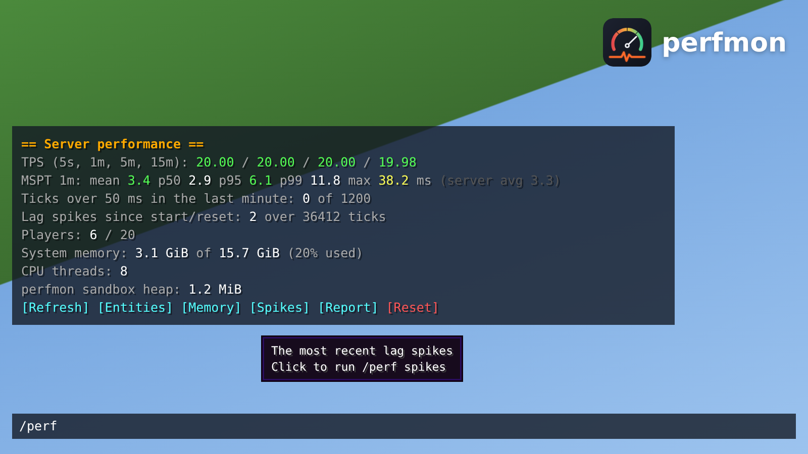

# perfmon: performance and debug plugin for Pumpkin


`Perfmon.wasm` is a [Pumpkin](https://github.com/Pumpkin-MC/Pumpkin) plugin. It times every server
tick, keeps 15 minutes of history, flags lag spikes, graphs tick times, counts entities, reports
memory and player ping, logs metrics to a CSV file, and tells you when a newer release is out.



## Install

1. Download `Perfmon.wasm` from the [latest release](https://github.com/Xathr/Perfmon/releases/latest),
   or install it from the Pumpkin Market.
2. Put it in your server's `plugins/` folder.
3. Pre-approve its permissions in `pumpkin.toml` (see [Permissions](#permissions)) and restart.

Built against Pumpkin 0.2.2 (commit `eda6944`, plugin API v0.1).

## Commands

`/perf` (aliases `/tps`, `/lag`) needs operator level 2, or the `perfmon:perf` permission.

| Command | Shows |
|---|---|
| `/perf` | TPS over 5 s, 1 m, 5 m and 15 m; tick time mean, p50, p95, p99 and max; ticks over 50 ms; spike count; players; memory |
| `/perf graph` | Tick times as two bar graphs: the last minute (2 s per bar) and the last 15 minutes (30 s per bar) |
| `/perf ping` | Every player's ping, highest first, and the average |
| `/perf entities` | Entity and player counts per dimension, and the 10 most common entity types |
| `/perf heap` | System memory, CPU threads, and this plugin's own sandbox memory |
| `/perf spikes` | The 10 most recent lag spikes, with how long ago and how long they took |
| `/perf report` | Writes a full report to `plugins/data/perfmon/report-<unix time>.txt`, including the last 1200 tick times |
| `/perf update` | Whether a newer perfmon release is out (see [Updates](#updates)) |
| `/perf reset` | Clears the tick history and spike list |

In the server console, `/perf` output and perfmon's log lines are coloured.

Output is clickable in game: a button bar under each result runs the other subcommands, numbers
explain themselves on hover, spike tick numbers and report paths copy on click, and **[Reset]**
only fills in the chat box so it can't be triggered by accident.

TPS is worked out from tick durations: a tick that takes under 50 ms counts as 50 ms, because the
server sleeps for the rest. Colours: green is healthy, yellow is close to the limit, red is lagging.

## Updates

When the server starts, perfmon asks GitHub for its [latest release](https://github.com/Xathr/Perfmon/releases/latest)
and compares it with the version that is running. If a newer one is out it says so in the console,
and tells operators in game a few seconds after they join, with a link to the release notes.

| Command | Does |
|---|---|
| `/perf update` | Shows what the last check found |
| `/perf update check` | Asks GitHub again now |
| `/perf update download` | Saves the new `Perfmon.wasm` to `plugins/data/perfmon/update/Perfmon.wasm` |

A download is checked against the SHA-256 published with the release, and is not saved if it does
not match. Pumpkin does not let a plugin write to `plugins/`, so the last step is yours: stop the
server and copy `plugins/data/perfmon/update/Perfmon.wasm` over `plugins/Perfmon.wasm`. With
`update_download = true` the download happens by itself at startup.

The check at startup runs before the server ticks. `/perf update check` and
`/perf update download` run while it is ticking, and the server may pause until GitHub answers
(at most a few seconds if GitHub cannot be reached).

The check needs the `http.outbound` permission. To turn it off, set `update_check = false`, or
block the permission (see [Permissions](#permissions)). Nothing about your server is sent: the
request is a plain GET of the public release data.

## Memory

Pumpkin gives plugins the machine's total and used memory, not its own heap. `/perf heap` shows
the machine figure and perfmon's own WebAssembly memory. To see Pumpkin's own memory on Linux:

```bash
ps -o rss=,vsz= -C pumpkin
```

## Metrics log

Every `csv_interval_secs` seconds a line is added to `plugins/data/perfmon/metrics.csv`:

```
unix,tps_1m,mspt_mean,mspt_p95,mspt_max,ticks_over_50ms,spikes_total,players,entities,used_memory_bytes,plugin_heap_bytes
```

Open it in a spreadsheet to graph performance over hours or days.

## Config

`plugins/data/perfmon/config.toml` is written on first start. Restart the server after editing.

```toml
spike_threshold_ms = 100        # a tick at least this long is a lag spike
warn_on_spike = true            # log a console warning for spikes
spike_warn_cooldown_secs = 10   # at most one warning per this many seconds
csv_interval_secs = 60          # 0 turns the CSV log off
csv_count_entities = true       # count entities for each CSV line
console_colors = true           # coloured output in the server console (false = plain text)
update_check = true             # ask GitHub for the latest release when the server starts
update_notify_ops = true        # tell operators in game when a newer release is out
update_download = false         # download a newer Perfmon.wasm into the data folder at startup
```

A config file written by an older version keeps working: settings it does not have use the
defaults above.

## Permissions

`sys.info` for memory and CPU figures, `fs.read.data` and `fs.write.data` for its config, CSV,
reports and downloaded updates in its own data folder, and `http.outbound` for the update check.
Pre-approve them in `pumpkin.toml`:

```toml
[plugins.overrides.perfmon]
allowed_permissions = ["sys.info", "fs.read.data", "fs.write.data", "http.outbound"]
```

`http.outbound` is new in 0.3.0: if you pre-approved the other three for an older version, add it,
or Pumpkin asks for confirmation on the next start. To run perfmon with no network access, block
it instead; everything but the update check works the same:

```toml
[plugins.overrides.perfmon]
allowed_permissions = ["sys.info", "fs.read.data", "fs.write.data"]
blocked_permissions = ["http.outbound"]
```

## Building

```bash
./build.sh        # Linux/macOS, or .\build.ps1 on Windows
```

The file is `target/wasm32-wasip2/release/Perfmon.wasm`. Pushing a `v*` tag builds it on GitHub
Actions and attaches it to a release.

## License

GPL-3.0. See [LICENSE](LICENSE).
