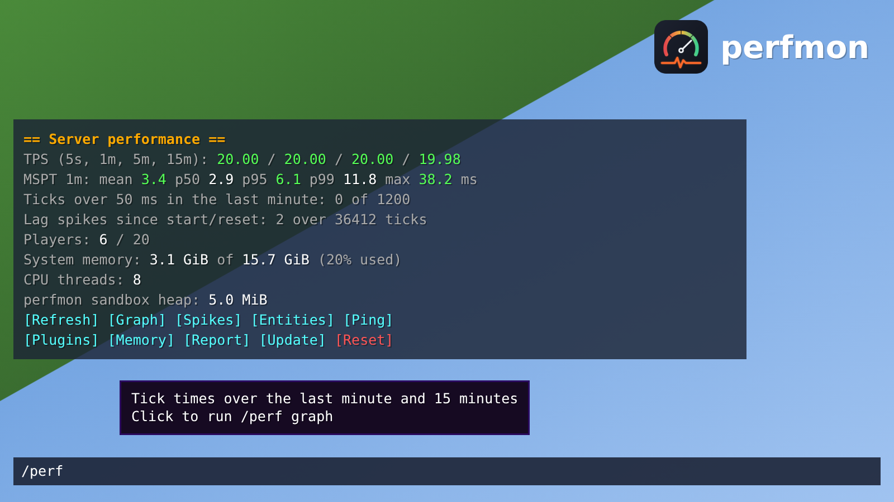
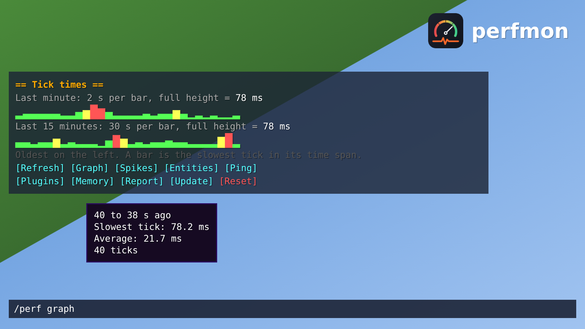
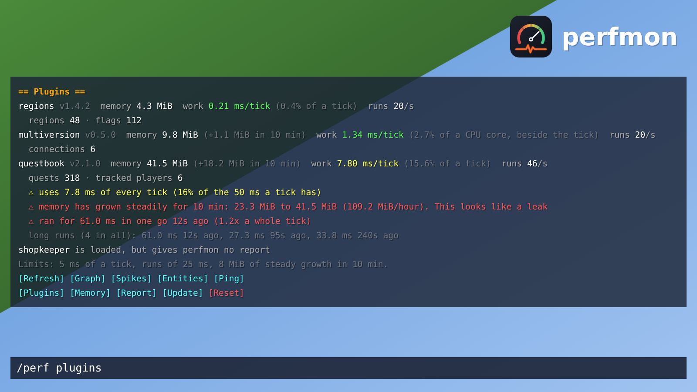
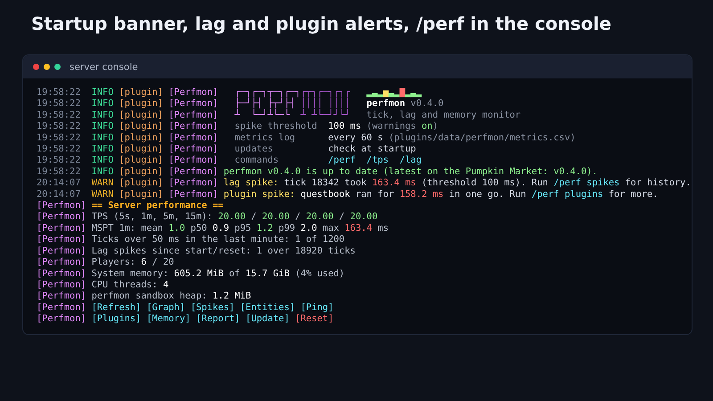

# perfmon — know why your server lags

**perfmon** watches every single server tick and tells you, in game or from the console, exactly how healthy your Pumpkin server is. No guessing from a single TPS number: see tick-time percentiles, catch lag spikes the moment they happen, find which mobs are piling up, and keep a CSV history you can graph.



## Features

- ⏱️ **Real TPS over 5 s, 1 m, 5 m and 15 m**, worked out from measured tick times
- 📊 **Tick-time percentiles**: mean, p50, p95, p99 and worst tick in the last minute
- ⚠️ **Lag spike alerts**: a console warning when a tick passes your threshold (100 ms by default), with a spike history
- 📉 **Tick-time graphs** in chat or the console: the last minute and the last 15 minutes, a bar per time span
- 📶 **Player ping**: everyone's ping, highest first, and the average
- 🐄 **Entity counts** per dimension, plus the 10 most common mob types, to find farms and mob pile-ups
- 🧠 **Memory**: machine memory and whether it keeps growing, CPU threads, and the plugin's own footprint
- 🧩 **Plugin watch**: for plugins that report to perfmon, their memory, time per tick and longest runs, with warnings when one lags, spikes or looks like it leaks. Pumpkin does not let a plugin measure another, so plugins opt in (a short how-to for authors is in the README)
- 📝 **One-command reports**: `/perf report` writes everything, including the last 1,200 tick times, to a text file you can share
- 📈 **CSV metrics log**: one line a minute in `metrics.csv`, ready to graph in any spreadsheet
- 🖱️ **Clickable chat**: a button bar under every result, hover explanations on each number, click-to-copy report paths
- 🔔 **Update check**: tells the console and operators when a newer version is on the Market, and can download the signed file, checking its signature first
- 🎨 Colour coded: green is healthy, yellow is close to the limit, red is lagging
- 🖥️ **Startup banner** with the spike threshold, CSV log and commands, and every console line tagged `[Perfmon]`, including `/perf` output in the console
- 🪶 Lightweight: one small event per tick, no extra threads, about 1 MB of memory





## Setup

1. Put `Perfmon.wasm` in your server's `plugins/` folder and start the server.
2. Answer `y` when Pumpkin asks to approve the plugin's permissions (or pre-approve them, see below).
3. Run `/perf` in game or in the console. There is nothing else to set up, on Linux or Windows.



## Commands

| Command | What it shows |
|---|---|
| `/perf` | TPS, tick-time percentiles, spikes, players and memory |
| `/perf graph` | Tick times as bar graphs: last minute and last 15 minutes |
| `/perf ping` | Every player's ping and the average |
| `/perf entities` | Entities and players per dimension, top mob types |
| `/perf heap` | Memory, how it changed over 10 minutes, and CPU threads |
| `/perf plugins` | Memory, time per tick and long runs of each plugin that reports to perfmon, with warnings for lag, spikes and suspected leaks |
| `/perf spikes` | The 10 most recent lag spikes |
| `/perf report` | Writes a full report file |
| `/perf update` | Whether a newer version is out; `check` asks again, `download` fetches it |
| `/perf reset` | Clears the history |

`/tps` and `/lag` work as aliases. Commands need operator level 2 or the `perfmon:perf` permission.

## For plugin authors: answering perfmon

Pumpkin does not let one plugin measure another, so `/perf plugins` only has numbers for plugins that report them. Adding that to your own plugin takes two small JSON messages.

Two messages, both JSON, sent with Pumpkin's plugin-to-plugin call (`send_ipc_message` and
`Plugin::handle_ipc_message`):

1. Once the server is ticking, send `{"perfmon":1,"hello":"<your plugin's name>"}` to the plugin
   named `perfmon`. If the call fails, perfmon isn't loaded (yet): try again in a minute.
2. When you receive `{"perfmon":1,"ask":"report"}`, answer:

```json
{"perfmon":1, "name":"myplugin", "version":"1.0.0",
 "memory_bytes":4194304, "work_us":81234567, "calls":40211, "max_us":1840,
 "gauges":[{"name":"sessions","value":12}]}
```

| Field | Meaning |
|---|---|
| `memory_bytes` | Your sandbox's memory now: `core::arch::wasm32::memory_size(0) * 65536` |
| `work_us` | Microseconds your code has run since it loaded. Time every entry point Pumpkin calls: tasks, event handlers, commands |
| `calls` | How many such runs there have been |
| `max_us` | The longest single run since your previous report; start it over each time you answer |
| `gauges` | Up to 16 numbers of your own to show, each with a `name` and optionally a `unit` |

Every field but `perfmon` is optional: leave out what you don't measure. If your work runs
beside the server tick instead of inside it (a network loop, for instance), add
`"off_tick":true` and count only the time you are busy, not the time you wait: perfmon then shows
it as CPU used and never puts a slow tick down to you. `work_us` and `calls`
only ever go up; if they go down perfmon takes it that the plugin was reloaded and starts over.
[Cascade's `src/report.rs`](https://github.com/Xathr/Cascade/blob/main/src/report.rs) is a
complete example in about 70 lines.

## Configuration

`plugins/data/perfmon/config.toml` is created on first start. Every setting is optional:

```toml
spike_threshold_ms = 100        # a tick at least this long counts as a lag spike
warn_on_spike = true            # log a console warning on spikes
spike_warn_cooldown_secs = 10   # at most one warning per this many seconds
csv_interval_secs = 60          # 0 turns the CSV log off
csv_count_entities = true       # include the entity count in each CSV line
console_colors = true           # coloured console output
update_check = true             # ask the Pumpkin Market for the latest version at startup
update_notify_ops = true        # tell operators in game when a newer version is out
update_download = false         # download a newer, signed Perfmon.wasm into the data folder at startup
plugins = []                    # plugins to ask for a report, by name; ones that introduce themselves need no entry
plugin_poll_secs = 1            # how often watched plugins are asked; 0 turns plugin watching off
plugin_lag_ms = 5.0             # warn when a plugin uses this much of every tick, averaged over a minute
plugin_spike_ms = 25            # one run of a plugin's code this long is a plugin spike
plugin_leak_mb = 8              # warn when a plugin's memory grew steadily by this much in 10 minutes
warn_on_plugin_problem = true   # log plugin lag, spikes and suspected leaks to the console
```

## Permissions it asks for

| Permission | Why |
|---|---|
| `sys.info` | Machine memory and CPU thread count |
| `fs.read.data` | Reading its config |
| `fs.write.data` | Its config, `metrics.csv`, reports and downloaded updates, only inside its own data folder |
| `http.outbound` | The update check: a GET of this plugin's latest version from the Pumpkin Market, and the signed download if you ask for it |

The update check is perfmon's only network use, and nothing about your server is sent. Turn it off with `update_check = false`, or block `http.outbound`.

A downloaded update is saved as `plugins/data/perfmon/update/Perfmon.wasm`. Plugins cannot write to `plugins/`, so stop the server and copy it over `plugins/Perfmon.wasm` yourself.

To skip the permission prompt on start, add this to `pumpkin.toml`:

```toml
[plugins.overrides.perfmon]
allowed_permissions = ["sys.info", "fs.read.data", "fs.write.data", "http.outbound"]
```

## Good to know

Pumpkin gives plugins the machine's memory, not the server's own heap. On Linux, `ps -o rss= -C pumpkin` shows the server's own memory.

Built for Pumpkin 0.2.2 (Minecraft 26.3, plugin API v0.1).

Open source under GPL-3.0. Issues and ideas are welcome on GitHub.
