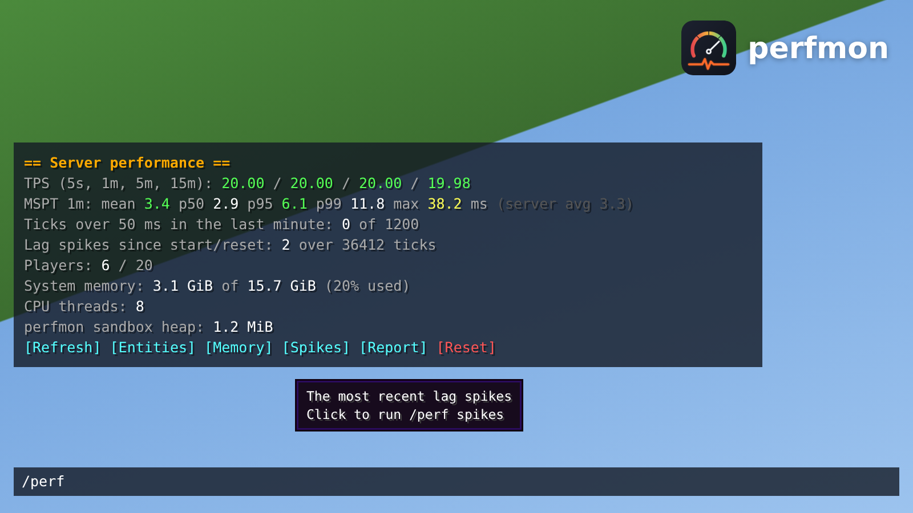
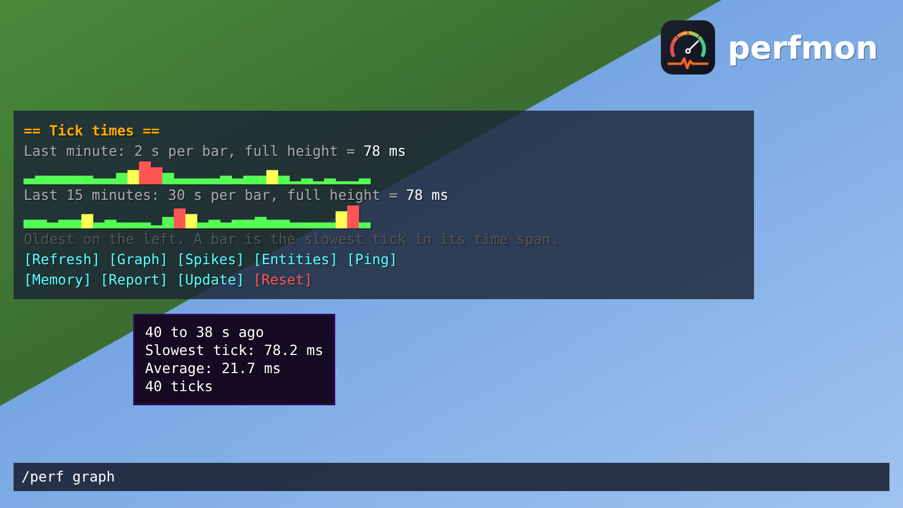
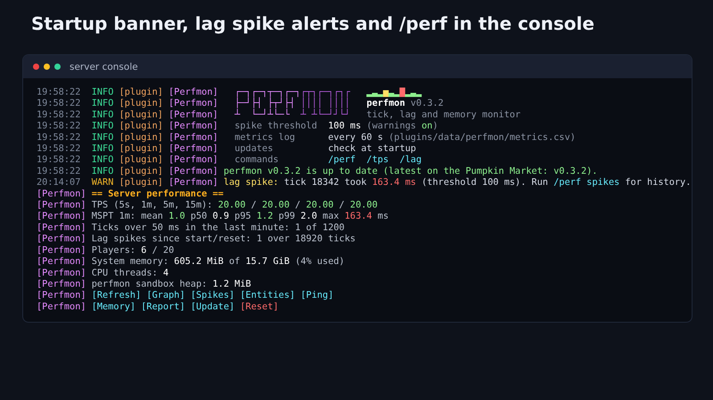

# perfmon — know why your server lags

**perfmon** watches every single server tick and tells you, in game or from the console, exactly how healthy your Pumpkin server is. No guessing from a single TPS number: see tick-time percentiles, catch lag spikes the moment they happen, find which mobs are piling up, and keep a CSV history you can graph.



## Features

- ⏱️ **Real TPS over 5 s, 1 m, 5 m and 15 m**, worked out from measured tick times
- 📊 **Tick-time percentiles**: mean, p50, p95, p99 and worst tick in the last minute
- ⚠️ **Lag spike alerts**: a console warning when a tick passes your threshold (100 ms by default), with a spike history
- 📉 **Tick-time graphs** in chat or the console: the last minute and the last 15 minutes, a bar per time span
- 📶 **Player ping**: everyone's ping, highest first, and the average
- 🐄 **Entity counts** per dimension, plus the 10 most common mob types, to find farms and mob pile-ups
- 🧠 **Memory**: machine memory, CPU threads, and the plugin's own footprint
- 📝 **One-command reports**: `/perf report` writes everything, including the last 1,200 tick times, to a text file you can share
- 📈 **CSV metrics log**: one line a minute in `metrics.csv`, ready to graph in any spreadsheet
- 🖱️ **Clickable chat**: a button bar under every result, hover explanations on each number, click-to-copy report paths
- 🔔 **Update check**: tells the console and operators when a newer version is on the Market, and can download the signed file, checking its signature first
- 🎨 Colour coded: green is healthy, yellow is close to the limit, red is lagging
- 🖥️ **Startup banner** with the spike threshold, CSV log and commands, and every console line tagged `[Perfmon]`, including `/perf` output in the console
- 🪶 Lightweight: one small event per tick, no extra threads, about 1 MB of memory



## Setup

1. Put `Perfmon.wasm` in your server's `plugins/` folder and start the server.
2. Answer `y` when Pumpkin asks to approve the plugin's permissions (or pre-approve them, see below).
3. Run `/perf` in game or in the console. There is nothing else to set up, on Linux or Windows.



## Commands

| Command | What it shows |
|---|---|
| `/perf` | TPS, tick-time percentiles, spikes, players and memory |
| `/perf graph` | Tick times as bar graphs: last minute and last 15 minutes |
| `/perf ping` | Every player's ping and the average |
| `/perf entities` | Entities and players per dimension, top mob types |
| `/perf heap` | Memory and CPU threads |
| `/perf spikes` | The 10 most recent lag spikes |
| `/perf report` | Writes a full report file |
| `/perf update` | Whether a newer version is out; `check` asks again, `download` fetches it |
| `/perf reset` | Clears the history |

`/tps` and `/lag` work as aliases. Commands need operator level 2 or the `perfmon:perf` permission.

## Configuration

`plugins/data/perfmon/config.toml` is created on first start. Every setting is optional:

```toml
spike_threshold_ms = 100        # a tick at least this long counts as a lag spike
warn_on_spike = true            # log a console warning on spikes
spike_warn_cooldown_secs = 10   # at most one warning per this many seconds
csv_interval_secs = 60          # 0 turns the CSV log off
csv_count_entities = true       # include the entity count in each CSV line
console_colors = true           # coloured console output
update_check = true             # ask the Pumpkin Market for the latest version at startup
update_notify_ops = true        # tell operators in game when a newer version is out
update_download = false         # download a newer, signed Perfmon.wasm into the data folder at startup
```

## Permissions it asks for

| Permission | Why |
|---|---|
| `sys.info` | Machine memory and CPU thread count |
| `fs.read.data` | Reading its config |
| `fs.write.data` | Its config, `metrics.csv`, reports and downloaded updates, only inside its own data folder |
| `http.outbound` | The update check: a GET of this plugin's latest version from the Pumpkin Market, and the signed download if you ask for it |

The update check is perfmon's only network use, and nothing about your server is sent. Turn it off with `update_check = false`, or block `http.outbound`.

A downloaded update is saved as `plugins/data/perfmon/update/Perfmon.wasm`. Plugins cannot write to `plugins/`, so stop the server and copy it over `plugins/Perfmon.wasm` yourself.

To skip the permission prompt on start, add this to `pumpkin.toml`:

```toml
[plugins.overrides.perfmon]
allowed_permissions = ["sys.info", "fs.read.data", "fs.write.data", "http.outbound"]
```

## Good to know

Pumpkin gives plugins the machine's memory, not the server's own heap. On Linux, `ps -o rss= -C pumpkin` shows the server's own memory.

Built for Pumpkin 0.2.2 (Minecraft 26.3, plugin API v0.1).

Open source under GPL-3.0. Issues and ideas are welcome on GitHub.
